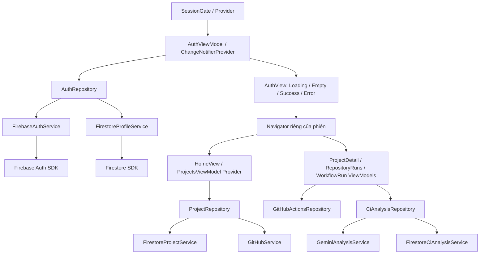

# Kiến trúc Flutter hiện hành

Ngày cập nhật: 04/11/2026. Phạm vi: app Android trong `mobile/`, entrypoint `lib/main.dart`.
GitHub là phương thức đăng nhập được chọn cho dự án. Không thêm Google Sign-In ở bước này.

## Dependency và vòng đời

- View render state và chuyển input thành lệnh ViewModel; không gọi Firebase SDK.
- ViewModel là `ChangeNotifier`, giữ state và vòng đời tác vụ/subscription.
- Repository tổng hợp dữ liệu, mapping model và điều phối service.
- Service bọc thao tác SDK/HTTP. Firebase bootstrap ở `main.dart` là composition root.
- Provider tạo và dispose `AuthViewModel` trong `SessionGate`; `HomeView` tạo/dispose `ProjectsViewModel` bằng Provider. Các ViewModel CI theo route vẫn dùng constructor injection và được route dispose. Không dùng singleton ViewModel xuyên tài khoản.
- `SessionGate(repository: fake)` và constructor ViewModel nhận repository cho phép test thay dependency. Unit/widget tests dùng fake Auth/Project/GitHub/Analysis repositories; không cần OAuth hoặc quota AI thật.

## Phiên và bảo vệ màn hình

`FirebaseAuthService.authStateChanges()` chuyển SDK User thành `AuthIdentity` thuần Dart. AuthViewModel lắng nghe ngay khi khởi tạo, kể cả khi Firebase khôi phục phiên có sẵn. AuthRepository tạo hồ sơ còn thiếu bằng transaction rồi theo dõi hồ sơ từ server. Cache và pending writes không được dùng để mở Home lần đầu. Transaction kiểm tra UID hiện tại trước/sau khi đọc để tránh tạo hồ sơ từ một tác vụ của phiên cũ.

State phiên:

| State | UI |
|---|---|
| Loading | Đang xác minh phiên/hồ sơ, chưa dựng Home |
| Empty | Chưa đăng nhập, hiện GitHub login |
| Success | UID khớp, `isActive == true`, role `user`; mở Home |
| Error | Lỗi stream/quyền, profile thiếu/inactive/role không hợp lệ hoặc timeout; đóng màn được bảo vệ, cho retry/logout |

Timeout mặc định 20 giây. Retry hủy listener cũ và đăng ký lại. Generation bỏ kết quả profile cũ khi đổi UID/retry/dispose. Profile đang theo dõi có thể đóng quyền truy cập ngay khi server gửi cập nhật inactive/role hoặc lỗi quyền. Auth stream không tự thông báo mọi thay đổi do Admin SDK; việc disable Firebase Auth user trên Console vẫn cần SDK refresh/reload hoặc thao tác backend để phát hiện, không hứa phát hiện tức thì.

Mọi route project/form/run/analysis/comment và dialog xác nhận nằm dưới Navigator của phiên. Khi logout, UID thay đổi hoặc profile mất quyền, cả subtree bị gỡ và các ViewModel bị dispose; Back không mở lại màn cũ. Nút Back chuyển tab về Projects trước, sau đó mới xử lý navigation. Firestore Rules vẫn là lớp thực thi quyền dữ liệu.

Firebase giữ phiên native. GitHub access token vẫn chỉ giữ trong RAM, có UID chủ sở hữu và bị xóa khi đổi UID/logout. Cold start khôi phục phiên Vista nhưng không khôi phục GitHub token. Profile có nút **Kết nối lại GitHub**; reauthenticate cùng Firebase user, không lưu token xuống disk và không tự chuyển sang UID khác. Hoàn tất OAuth dựng lại scope dữ liệu để các ViewModel nhận token mới.

## State dữ liệu

`core/state/async_state.dart` định nghĩa `AsyncState<T>` với bốn trạng thái `loading`, `success`, `empty`, `error`, dữ liệu và thông báo lỗi.

- Auth giữ state phiên trực tiếp; lỗi auth/profile không giữ dữ liệu được bảo vệ.
- Projects, repository picker, tổng quan repo, lịch sử run, run detail, phân tích AI, preview, PR và từng job log cung cấp snapshot `AsyncState` chỉ đọc. Snapshot được tính từ trạng thái nội bộ hiện có để tránh lưu trùng hai nguồn state.
- Loading/error dữ liệu có thể giữ kết quả cũ để refresh không xóa màn hình; UI vẫn hiển thị chỉ báo loading/error. Error không bị coi là Empty. Dữ liệu danh sách/map trong snapshot được bọc unmodifiable.
- Các cờ thao tác ghi như saving/rerun/posting và kết quả chưa rõ vẫn tách riêng vì có thể diễn ra cùng trạng thái dữ liệu. Không gom mọi tác vụ vào một cờ loading toàn màn hình.

## Code lịch sử và tài liệu

`mobile/lib/features/` chứa implementation của các mốc workspace trước; không phải luồng được `main.dart` mở hiện tại. Không dùng việc code legacy có auth stream để kết luận entrypoint hiện hành đã theo dõi phiên. Tài liệu các bước 01–24 và handover cũ là lịch sử; khi khác biệt, đối chiếu entrypoint và tài liệu này.

## Kiểm chứng

Chạy trong `mobile/`: `flutter analyze --no-pub`, `flutter test --no-pub`.

Kết quả kiểm tra ngày 04/11/2026: analyze không có issue; toàn bộ **108 test passed**. Đây là kết quả unit/widget tests ở local, chưa phải nghiệm thu Firebase trên thiết bị.

Test mới kiểm tra khôi phục phiên chờ profile, Provider disposal, logout từ bên ngoài khi route còn mở, profile inactive, UID A/B với kết quả trễ, lỗi quyền/retry và timeout/unknown role. Test widget cũ tiếp tục kiểm tra login/logout, lỗi OAuth, nút Back, giữ tìm kiếm và các luồng project/CI.

Các test dùng fake không chứng minh OAuth/SHA/App Check/Rules đã hoạt động trên thiết bị thật. Kiểm tra Android tiếp theo: login GitHub → force-stop/mở lại → profile được khôi phục → kết nối lại GitHub → tải repo/CI → logout → Back không thấy dữ liệu cũ.

Tham khảo API: [Provider](https://github.com/rrousselgit/provider/blob/master/packages/provider/README.md), [Firebase Auth state và persistence](https://firebase.google.com/docs/auth/flutter/start), [GitHub provider](https://firebase.google.com/docs/auth/flutter/federated-auth).

## Analytics / Crashlytics / Remote Config — 05/11/2026

`AppRuntime` là composition root của ba service Firebase mới. AuthViewModel và các ViewModel nghiệp vụ nhận `AppTelemetry` qua constructor; Firebase SDK chỉ nằm trong Service. `TelemetryService` phối hợp hai sink Analytics/Crash để kiểm thử bằng fake, serialize identity với event và cô lập lỗi tracking khỏi nghiệp vụ.

`AppConfigViewModel` giữ cấu hình dùng chung suốt vòng đời app, không nằm trong scope dữ liệu theo UID. AuthViewModel truyền cấu hình xuống Projects/CI; WorkflowRunViewModel nghe cấu hình để cập nhật nút phân tích và kiểm tra lại feature flag tại cả prepare/analyze. ProjectDetailViewModel đọc page size khi tải trang. Defaults có sẵn trước khi fetch; lỗi fetch vẫn có UI fallback/retry trong Profile.

Analytics/User ID chỉ gắn sau khi profile hợp lệ; logout/đổi UID/profile mất quyền xóa định danh. Không gửi PII/raw lỗi/log/prompt/comment lên telemetry. Crash test được bảo vệ ở cả UI debug và method ViewModel/Service. Các chi tiết event, fallback và nghiệm thu xem [analytics plan](docs/analytics-plan.md) và [hướng dẫn tích hợp](docs/firebase-observability-setup.md).
