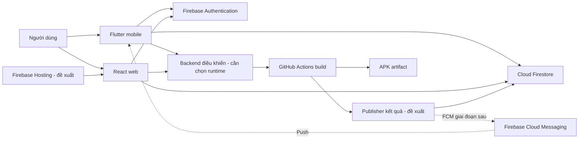
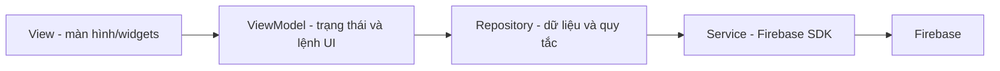

# 03. Kiến trúc và MVVM

**v0.3 - Kiến trúc đề xuất, chưa được áp dụng đầy đủ vào code - 01/11/2026**

## 1. Kiến trúc tối thiểu đề xuất



Firestore là dữ liệu phục vụ giao diện Vista; GitHub là nguồn run/conclusion/artifact. Authentication xác định người dùng. Security Rules quyết định client nào được đọc/ghi. Không đưa Spring Boot, MySQL, Neo4j hoặc Redis vào Vista chỉ vì SAGA sử dụng chúng.

MVP đã yêu cầu điều khiển workflow nên cần backend môi giới tin cậy, xem mục 5. Có thể chọn serverless để giảm vận hành và giữ máy cá nhân nhẹ; không bắt buộc server chạy thường trực. Publisher trên GitHub đảm nhiệm gửi kết quả, không thay endpoint nhận lệnh từ người dùng.

## 2. MVVM trên Flutter



- View nhận input, render loading/data/error và gọi lệnh của ViewModel.
- ViewModel quản lý state, validation phục vụ UI và vòng đời subscriptions; không chứa credential GitHub/Admin SDK.
- Repository là điểm truy cập dữ liệu của một feature; gom quyền truy cập dữ liệu, mapping và lỗi thành kiểu dùng được cho UI.
- Service bọc Firebase Auth/Firestore/FCM SDK. SDK không được gọi rải rác trong widget.

Đề xuất khởi đầu dùng `ChangeNotifier` của Flutter và constructor injection; chưa cần framework state management mới. Đổi thư viện sau này phải có lý do cụ thể. Hướng chia View/ViewModel/Repository/Service dựa trên [Flutter architecture guide](https://docs.flutter.dev/app-architecture/guide) và [recommendations](https://docs.flutter.dev/app-architecture/recommendations).

Cấu trúc dự kiến, **chưa tạo trong repo**:

```text
mobile/lib/
  main.dart
  app/                         # theme, route, khởi tạo phụ thuộc
  core/                        # kiểu lỗi, tiện ích chung có nhu cầu thực
  features/
    auth/                      # view, view_model, repository, service, model
    projects/
    runs/
    notifications/             # giai đoạn sau MVP, khi luồng chính ổn định
```

Mỗi feature giữ ít file đủ dùng; không tạo trước toàn bộ use-case/domain/DI framework cho một ứng dụng nhỏ. Code hiện tại vẫn tập trung ở `main.dart`, chưa phải bản MVVM hoàn chỉnh.

## 3. Tổ chức React web

Đề xuất `features/auth`, `features/projects`, `features/runs`; mỗi feature gồm component, hook điều khiển trạng thái và service/repository gọi Firebase. Route guard điều hướng theo quyền; Firestore Rules vẫn là lớp thực thi quyền dữ liệu.

Không buộc React phải có class ViewModel giống Flutter. Hai client dùng cùng hợp đồng dữ liệu và quyền, không cần dùng chung mã Dart/TypeScript. Khi logout phải hủy listeners và xóa state nhạy cảm.

## 4. Đồng bộ kết quả với chi phí nhẹ

Phương án đề xuất là một workflow publisher riêng trên nhánh mặc định, chạy khi workflow build hoàn tất (`workflow_run: completed`). Publisher chỉ xử lý source repository/nhánh được duyệt, không tải/chạy code hoặc script từ PR để xử lý kết quả.

Publisher xác thực máy chủ, đọc run metadata rồi ghi Firestore. Cấu hình dễ hiểu để đánh giá ban đầu: service account có quyền cần thiết, credential lưu trong GitHub Secret và chỉ cấp cho publisher tin cậy. Không đưa credential này vào mobile, web, artifact, log hoặc Firestore.

Không mặc định Workload Identity Federation dùng trực tiếp được với mọi Firebase Admin SDK. Tài liệu [google-github-actions/auth](https://github.com/google-github-actions/auth) đang có cảnh báo tương thích ở mục WIF; nếu chọn WIF phải kiểm tra đúng SDK/luồng xác thực hoặc dùng API có access token được hỗ trợ. Đây là quyết định triển khai sau khi duyệt, chưa cấu hình credentials ở lần soạn tài liệu này.

Đề xuất publisher xử lý các build `push` ở `main` của repository cho phép trước. Dữ liệu PR/fork và queued/running là mở rộng. Cách tách publisher cũng cho phép ghi nhận build failed/cancelled, thay vì phụ thuộc một bước chỉ chạy khi build thành công.

## 5. Backend điều khiển chạy/chạy lại - bắt buộc trong MVP

D04 đã được xác nhận: cần callable/HTTP Cloud Function hoặc một backend tin cậy tương đương. Runtime, chi phí, vai trò và client được thao tác chưa chốt:

```text
Client được duyệt -> Firebase ID token -> Backend kiểm tra quyền/project
          -> GitHub API -> request ID/run ID -> Firestore -> UI
```

Backend cần chặn project/ref/workflow ngoài allowlist, giữ GitHub App key/token ở server, lưu audit và phân biệt “đã nhận yêu cầu” với “run hoàn tất”. Không dùng Firebase client SDK để gửi GitHub token bí mật xuống trình duyệt.

Cloud Functions for Firebase yêu cầu nâng cấp Blaze để deploy; free tier không có nghĩa giữ được Spark. Vì vậy backend điều khiển và ngân sách phải được bạn duyệt trước. [Firebase Functions](https://firebase.google.com/docs/functions), [pricing](https://firebase.google.com/pricing).

## 6. FCM - đã chốt làm sau MVP

FCM đã được chốt làm sau khi đăng nhập, chạy/chạy lại và xem kết quả thật ổn định; không phải điều kiện hoàn thành MVP ban đầu. FCM không thay Firestore. App mở lại luôn đọc trạng thái chuẩn trong Firestore dù đã nhận hoặc bỏ lỡ push. Kiểm tra ban đầu có thể gửi test message từ Firebase Console; thông báo tự động chỉ thêm khi publisher và thiết bị được kiểm chứng.

Sender ở môi trường tin cậy; không gửi FCM bằng khóa server từ client. [FCM server environment](https://firebase.google.com/docs/cloud-messaging/server-environment).

## 7. Cấu hình Firebase theo nền tảng

Hiện Android đã có `google-services.json`, Google Services plugin và `Firebase.initializeApp()`. Web chưa có Firebase SDK/config trong repo; iOS Firebase chưa thiết lập.

Cấu hình Firebase client có thể hiện diện trong app; service account/private key là loại credential khác, phải nằm ngoài client. Mật khẩu, role hoặc phiên làm việc không được tự lưu thành JSON trong Firestore thay cho Firebase Authentication. Việc Auth/Firestore/FCM cùng thuộc Firebase không làm chúng tự động bật khi thêm `firebase_core`. Xem [Firebase client configuration](https://firebase.google.com/docs/projects/learn-more#config-files-objects).
